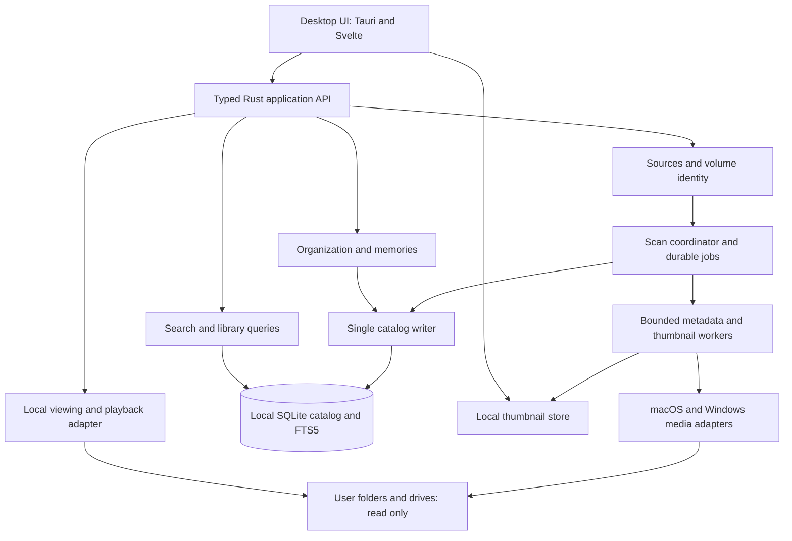

# Bimb architecture

Approved design — 10 October 2026. This document defines the intended architecture and release criteria. The first Apple Silicon preview is implemented; see `validation.md` for measured results, implementation simplifications, and remaining validation. Do not treat every design target below as a completed acceptance check.

## Shape of the system

Use one desktop application with a modular Rust core, a local SQLite catalog, a thumbnail store, and bounded media worker processes. Keep the design simple for 3,000 items while avoiding memory and identity decisions that would force a rewrite for larger libraries.

The cache arrow represents an authorized local asset protocol; the frontend never receives unrestricted filesystem access.

## Components and responsibilities

| Component | Owns | Boundary |
|---|---|---|
| Desktop UI | Grid virtualization, viewer controls, filter controls, source setup, accessible keyboard navigation | Sends typed commands; receives bounded result pages and progress events. No SQL or indexing logic. |
| Application API | Input validation, source authorization, command/query coordination | Stable asset/source IDs instead of arbitrary user-controlled filesystem paths. |
| Library domain | Assets, annotations, albums, effective metadata, memory exclusions | Independent of Tauri and platform APIs. |
| Catalog | Schema, migrations, queries, FTS, transactional updates, backup | rusqlite behind a catalog interface; one writer thread plus a small read pool. |
| Source registry | Volumes, mount sessions, roots, exclusions, access state and relinking | OS adapter supplies identity/access facts; domain decides matches conservatively. |
| Indexer | Enumeration, reconciliation, job scheduling, priorities, cancellation and retry | Streaming traversal with bounded queues; no full library materialization. |
| Media adapter | Metadata extraction, thumbnail decode, oriented/color-correct output | Native macOS APIs first; operation-specific results. Workers have resource limits. |
| Thumbnail store | Atomic files, derivative keys, byte accounting, retention | Rebuildable only while originals are accessible; explicit purge controls. |
| Search/memories | Safe query construction, date/place collections, exclusion rules | Uses catalog data only; no original reads or network calls. |
| Recovery/export | Consistent snapshots, restore validation, annotation export | Distinguish catalog backup from original-media backup. |
| Future analyzers | Versioned ML jobs and results | Introduce when needed; never overwrite confirmed user annotations. |

Suggested initial workspace boundaries: `bimb-core`, `bimb-catalog`, `bimb-indexer`, `bimb-media`, `bimb-platform`, and the desktop host. These are conceptual responsibilities; avoid one crate per small abstraction.

## Technology choices and tradeoffs

**Rust core with Tauri 2 and Svelte/TypeScript UI.** This keeps filesystem access, scheduling, identity, queries, and memory-intensive work in Rust, with a shared desktop UI. Tauri uses WebView2 on Windows and WKWebView on macOS, so rendering/playback must be tested on each target. Capabilities constrain frontend exposure but do not replace checks inside custom Rust commands. Configure the command allowlist explicitly. [Webviews](https://v2.tauri.app/reference/webview-versions/), [capabilities](https://v2.tauri.app/security/capabilities/).

**SQLite through rusqlite, with FTS5.** A single local catalog avoids a separate database service and a separate search-index consistency problem. Use explicit parameterized SQL and transactions. Ordinary indexes handle dates, sources, types, favorites, and sort keys; FTS handles text. Quote user text into literal FTS terms rather than exposing raw FTS syntax. Keep FTS updates transactional with metadata/annotations. Filename substring search can initially use a bounded SQL fallback; revisit only with measurements. [rusqlite](https://docs.rs/rusqlite/latest/rusqlite/), [FTS5](https://www.sqlite.org/fts5.html).

**Local database with WAL.** Put it in the per-user application-data directory on a local disk, outside managed sources and cloud-synchronized folders. WAL supports concurrent readers but not a shared network catalog. Use a patched bundled SQLite version, short transactions, bounded busy retries, and controlled checkpoints. The upstream WAL-reset bug was fixed in 3.51.3 and selected backports; verify the actual bundled version at implementation time. Start with `synchronous=FULL` for annotation durability and tune only with evidence. [SQLite WAL documentation](https://www.sqlite.org/wal.html).

**Native media adapter first.** Image I/O provides image metadata and thumbnails; AVFoundation provides video asset access and frame extraction. A Rust interface hides platform-specific bindings and a minimal native bridge where necessary. Prefer downsampled decoding and embedded previews over full-resolution decode. This avoids choosing a large cross-platform codec bundle before validating the initial phone files. [Image I/O](https://developer.apple.com/documentation/imageio), [video frame extraction](https://developer.apple.com/documentation/avfoundation/creating-images-from-a-video-asset).

The Windows increment uses WinRT/WIC image codecs and OS video properties/thumbnails in a bounded subprocess. Codec parity and native Windows validation remain open; HEIC/HEVC depend on installed codecs, and playback also depends on WebView2. Evaluate any future bundled codec backend against actual gaps, distribution requirements and licenses. Do not claim HEVC support solely from a `.mov` extension or the existence of a browser video element.

## Identity and conceptual data model

| Entity | Essential information and invariant |
|---|---|
| Library | Stable ID, schema version, settings. One writable application owner per catalog. |
| Volume | Internal ID plus observed OS volume identifiers, filesystem characteristics, label, identity confidence. Mount path is a current observation, not identity. |
| Source | Stable ID, volume reference, selected relative root, display name, exclusions, access state, last completed scan. |
| Asset | Stable catalog ID for a media item. Organization references this ID, not its filename or hash. |
| File location | Asset ID, source/volume-relative native path, optional OS file ID, size, timestamps, revision, observation state. Preserve multiple locations when explicitly established. |
| Media metadata | Raw values, effective values, field provenance, extraction version and per-operation status. |
| Content fingerprint | Optional full digest and algorithm/version; bound to the file revision actually read. Not required for ordinary import. |
| Derivative | Asset/revision/recipe key, dimensions, orientation/color policy, local path, byte size, completion state. |
| Annotation | User tags, favorite, caption, date/place override, memory exclusion. Never silently replaced by rescans. |
| Album / membership | Stable references plus ordering, independent of source folders. |
| Scan / coverage | Generation, source mount-session ID, completed directory coverage, exclusions, errors, restart checkpoint. |
| Job | Kind, asset revision, extractor version, status, attempts, lease/heartbeat, next retry. Unique idempotency key. |
| Future analysis | Analyzer/model/version, asset revision, parameters, suggestions, user corrections. |

Initially, independent copies are separate assets. Equal filenames, sizes, or sampled hashes do not merge them. A rename can preserve identity when stable file identity plus revision evidence is sufficient; ambiguity invokes relinking or leaves entries separate. Identical files can have different user annotations, so later duplicate grouping must remain separate from destructive merging.

Store native paths losslessly: Unix bytes or Windows UTF-16 units, plus a separate searchable display string. Schema 4 records the catalog's path encoding and rejects foreign-OS catalogs before decoding paths; historical schemas 1–3 use macOS Unix bytes. Cross-OS remapping is not yet implemented. Do not lowercase stored paths, normalize Unicode blindly, or persist Rust's unspecified `OsStr::as_encoded_bytes()` representation as a portable format. [Rust OS strings](https://doc.rust-lang.org/std/ffi/index.html), [encoding restrictions](https://doc.rust-lang.org/std/ffi/os_str/struct.OsStr.html).

Volume identifiers may be unavailable, cloned, or differ across OSes. Corroborate them with root/file observations. Never attach a source solely because a drive letter or label matches. In ambiguous cases, show candidates and ask the user to relink; preserve asset IDs and annotations throughout.

## Indexing and reconciliation

1. Register and validate a source, detect overlapping roots, and capture a mount-session generation. Reject duplicate roots and offer to extend an existing source when the selection overlaps. Skip nested mounted volumes unless separately added.
2. Walk incrementally. Persist lightweight discoveries and directory coverage. Queue metadata and thumbnail work immediately without waiting for all enumeration to finish.
3. Use one active scan per source and source-relative file identity constraints to make rediscovery idempotent. Prioritize visible-item thumbnails, then background discovery/metadata, then remaining thumbnails.
4. Probe only what each operation requires. Avoid automatic full-file hashing, all-frame video analysis, and eager full video reads. Native readers can still seek or read substantial data; track actual time/bytes rather than promise constant I/O.
5. Compare file observations before and after work. If size/timestamps/file identity or the mount session changes, discard that result and retry after a settling interval. Persist a revision token and accept worker output only if it still matches.
6. Commit extracted metadata and job completion together. Thumbnail files use a temp file and atomic rename before their catalog record becomes ready. Crashes may leave orphan files; cleanup reconciles them. A ready record with a missing file becomes a repair job.
7. Reconcile absence only within directories whose enumeration completed successfully on the same verified mount session. Recheck suspected absent files before marking them missing. Incomplete/error subtrees retain prior observations.
8. Even confirmed missing files remain catalog entries until the user explicitly removes them. A disconnect, revoked permission, partial scan, cancellation, or I/O error never becomes a deletion.
9. Resume persisted work after restart; expire running job leases and retry safely. Rewalk incomplete directory chunks rather than persisting fragile OS directory handles. Already committed metadata/annotations remain valid.

Source access state (`online`, `offline`, `permission denied`, `ambiguous`, `unavailable`) is separate from scan state and file observation state. Metadata, thumbnail, playback, and future analysis statuses are also independent.

Filesystem events are hints. Debounce/coalesce them into reconciliations, with startup/reconnect/manual scans and a conservative low-frequency reconciliation while active. Notify documents backend/event limitations; exact frequency can be tuned to avoid unnecessarily waking removable disks. [notify documentation](https://docs.rs/notify/latest/notify/).

## Rust execution and resource management

- One catalog owner handles writes; a bounded command queue provides backpressure. A slow database must not create an unlimited in-memory job backlog.
- Run blocking traversal and database operations off the UI thread. Use async coordination where useful, with bounded blocking work; an async function does not make filesystem/decode operations nonblocking.
- Start with one media worker per removable source and at most two decoder workers globally. Tune using observed drive behavior; SSD parallelism must not make an HDD thrash.
- Decode memory is governed by a pixel/byte budget, not merely a worker count. Check dimensions before allocation where possible, cap metadata payloads, and enforce per-operation timeouts.
- Native decoders run in replaceable worker processes so a crash or hang does not take down the catalog/UI. Apply OS resource restrictions where supported. Process separation alone is not a complete security sandbox; scoped file handles/access and least privilege are still required.
- Do not hold a database transaction while reading a source or decoding media. Worker messages carry IDs, revisions, and small records, not full image buffers.
- Avoid `unsafe` in domain/index/catalog code. Keep required FFI narrowly encapsulated, with explicit ownership, callback lifetimes, cancellation and autorelease handling.
- Use keyset pagination with stable ID ties, bounded page sizes, thumbnail requests limited to the viewport, and coalesced progress events. Large binaries never travel as base64 JSON across the UI bridge.
- Treat pagination cursors as tied to a query and catalog generation; refresh deliberately when concurrent scans change results. Do not keep a read transaction open for an entire scrolling session.

## Dates, places, and memories

Store capture wall-clock time, offset when known, precision, original raw field, and provenance. Use user override first, then trustworthy embedded capture time, then file modification time explicitly labeled as a fallback. Import time is its own field. Do not invent UTC for timezone-less EXIF dates or silently treat filesystem creation time as capture time.

Timeline defaults to the effective capture wall date for intuitive travel browsing. “On this day” uses the user's current local calendar date against known capture month/day, excludes the current year, and excludes fallback/unknown dates unless the user opts in or corrects them. February 29 memories appear on February 29 initially. Date-range exclusions and per-item exclusions apply before results are selected.

Store embedded GPS separately from user place overrides. Invalid coordinates stay invalid; absent coordinates stay unknown. Named places are user annotations in the first release. No geocoding requests, downloaded map tiles, or device location tracking. Later geographic datasets need explicit size/license/version decisions.

## Failure and edge-case contract

| Situation | Required response |
|---|---|
| Drive unplugged during scan/playback | Stop affected work; retain catalog/thumbnails; show drive unavailable; resume after verified reconnect. |
| Same drive at a new mount path or letter | Relocate its mount binding using verified volume identity; retain source and asset IDs. |
| Different/cloned drive uses same name/ID | Corroborate identity; require explicit relinking when ambiguous. Do not silently associate originals. |
| Renamed file/folder | Preserve identity when established; otherwise offer conservative relinking and retain old annotations. |
| Symlink, junction, alias, loop | Do not follow links by default; skip/report them. Check approved-root containment at file access time. |
| Overlapping roots, hard links, multiple copies | Prevent duplicate scan coverage; treat identity evidence separately from content equality; never auto-delete. |
| Excluded or newly unreadable subtree | Record exclusion/error; do not mark its unseen contents missing. |
| File changes during read / partial phone copy | Discard stale result, bounded retry after settle; preserve last-known data marked stale. |
| File replaced at same path | Re-evaluate identity/revision; invalidate old derivatives; do not transfer user organization to an unrelated replacement without evidence. |
| File unchanged in size/mtime but content changed | Cheap scans cannot guarantee detection. Document this limit and provide an explicit deep rescan/verification action later; no integrity guarantee from timestamps. |
| iCloud/OneDrive placeholder | Detect when possible and skip with “not downloaded”; avoid reads that would implicitly hydrate content. Provider-specific detection is a validation requirement. |
| Apple Photos library package / direct phone attachment | Treat as unsupported import sources; use exported ordinary files. Do not traverse a managed photo-library database. |
| Corrupt/huge/decompression-bomb media | Limit work, terminate worker if needed, keep a basic catalog entry, report operation-specific failure. |
| Orientation, HEIC multi-image, HDR, wide gamut | Use primary image and correct transforms; produce sRGB SDR thumbnails with intentional tone mapping. Validate viewing/playback separately. |
| Video opens but thumbnail fails, or reverse | Keep independent statuses; do not hide otherwise usable media. |
| Read-only drive | Index normally; no source marker or sidecar writes required. |
| Catalog disk full | Roll back failed transaction, pause background writes, retain existing library; reserve bounded room for recovery where possible. |
| Thumbnail budget full | Retain existing thumbnails; pause new ones and expose storage controls. Metadata indexing can continue if catalog storage permits. |
| Worker crash, app kill, power loss | Replay idempotent jobs; recover database; reconcile derivative files; never mark an incomplete scan authoritative. |
| Corrupt catalog / failed migration | Preserve original database and backups; enter recovery flow. Reindexing cannot reconstruct user-only organization. |
| Two app instances / catalog on NAS | Enforce one writer owner; reject unsupported shared catalog location. |
| Non-UTF paths, long paths, case/Unicode differences | Lossless platform encoding and OS-aware comparisons; escaped display/search text does not become identity. |
| Search punctuation or malicious metadata | Parameterize SQL, quote FTS input, render metadata as text, validate IPC sizes and path access. |
| Source removed while jobs run | Invalidate source generation and cancel jobs; late results cannot repopulate removed entries. |
| Removing catalog entries then rescanning | Source removal unregisters its scan root. Future per-item “remove” must include an exclusion rule or explicitly state that rescan can rediscover it. |
| Sleep/wake or stale media handles | Revalidate source session; reopen safely; no assumed continuity of removable storage. |

This is a risk inventory, not a claim that every future codec, filesystem, or hardware failure is predictable. Newly discovered cases become explicit behavior and targeted regression checks.

## Recovery and privacy details

Keep annotations and source configuration as durable data; treat thumbnails, FTS, and extracted metadata as derived, although regeneration requires originals. Backups include schema/version metadata and user organization, with optional thumbnail inclusion for offline continuity. Explain the difference clearly during export.

Use SQLite's backup API for a consistent snapshot; do not copy a live database file alone. Validate a completed backup before replacing a previous one. Restore into a fresh location, validate, close catalog owners, then switch. Migrations take a validated snapshot first and run transactionally where supported; newer incompatible schemas refuse write access. [SQLite backup API](https://www.sqlite.org/backup.html).

Use owner-restricted application directories, scoped file access, a restrictive content security policy, and no remote UI origins. Logs default to event codes, timings, and IDs; filenames, GPS, captions, and extracted metadata are excluded from ordinary diagnostic logs. User-exported diagnostics must be inspectable. Temporary files and orphan thumbnails have bounded cleanup policies; removing cached images does not promise secure physical erasure on SSDs or in OS backups.

The viewer's local protocol resolves asset IDs to authorized sources, validates revisions/access, supports bounded/range reads where needed, and avoids exposing a general filesystem server. Decode and render user text as data. Opening an external player is an explicit user action.

## Necessary validation only

| Check | Why it exists |
|---|---|
| Scan/reconcile state-machine tests | Prove disconnect, permission failure, cancellation and incomplete coverage cannot become deletions. Include repeated scan idempotency and late stale-job rejection. |
| Identity/path fixtures | Verify relinks preserve organization, cloned labels do not silently bind, and native names/overlapping roots behave correctly. |
| Crash/recovery integration | Kill at database/thumbnail job boundaries; verify restart, annotations, retry, backup/restore and failed migration. Inject disk-full errors. |
| Small representative media corpus | Verify metadata, orientation, GPS/date provenance, thumbnails and playback for JPEG/PNG/HEIC/H.264/HEVC plus corrupt files and missing codecs. Include actual phone variants when available with consent. |
| Search/memory behavior | Verify filter combinations, stable sorting, unknown dates, offsets, leap day, punctuation, exclusion controls and rescanned user overrides. |
| Native platform smoke flow | Add, browse, play, disconnect, reconnect, restart and restore on actual Apple Silicon; repeat on Windows when introduced. |
| Offline/privacy check | Launch and use the installed app with network unavailable; inspect for unexpected outbound requests and sensitive logs. Verify zero application writes to original media. |
| Workload benchmark | Measure initial indexing, second scan, search latency, UI responsiveness and memory on 3,000 files / 1 TB. Use representative video duration/codec distributions. |

Do not unit-test trivial getters, generated bindings, framework internals, or every UI component. Use one focused test per important invariant, representative integration fixtures, and regressions for real bugs.

Proposed performance acceptance targets on the current Mac with a local SSD catalog: existing library grid usable within two seconds; warm metadata search p95 below 100 ms; common filter-to-grid update below 250 ms; thumbnails appear progressively; active indexing does not stall UI input. Targets exclude cold drive spin-up/full-resolution media loading and are subject to measurement and agreement. Keep combined normal indexing memory below a provisional 750 MiB budget, accounting for UI and worker processes. Measure playback separately.

No arbitrary first-scan time guarantee: codec, video layout, USB link and drive seek behavior dominate. Record scan throughput and actual work stages. Avoid a full 1 TB hash pass on ordinary import; deep content verification is a separately requested future feature.

## Packaging and future extension

First distribute a local Apple Silicon build for validation. Public macOS distribution needs signing/notarization and an agreed minimum OS; Windows packaging needs native validation and an offline WebView runtime installation path if Tauri is retained. Tauri documents an offline installer option. [Windows packaging](https://v2.tauri.app/distribute/windows-installer/).

Future ML consumes approved local media through the same scheduler, stores results by model and media revision, and supports cancel/delete/recompute. Face names and user corrections remain distinct from predicted clusters; changing models must not silently reassign names. CPU/GPU budgets and explicit model-package installation are part of that later design. Do not introduce a vector database, face schema, or arbitrary plugin runtime before the feature requires it.
