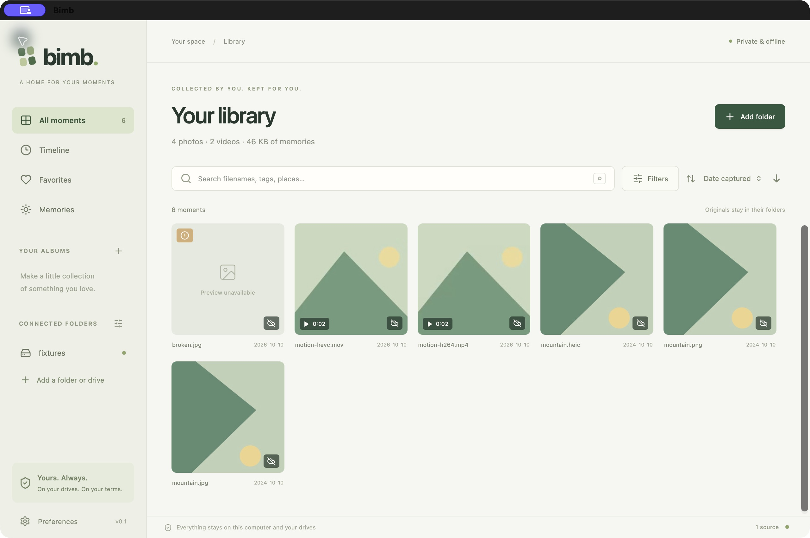
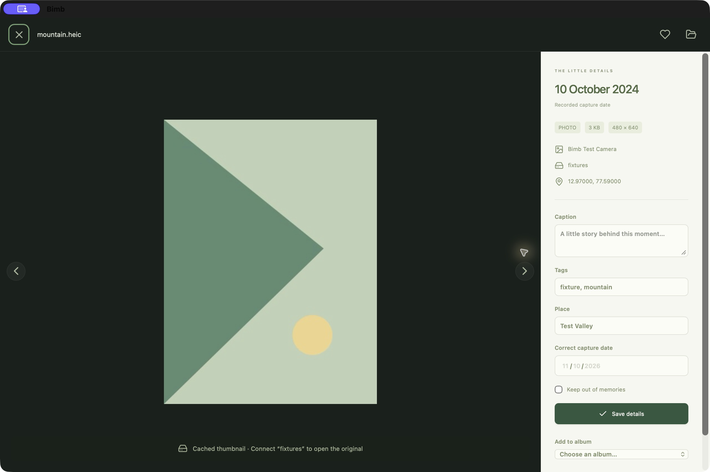

# Use Bimb

[Documentation home](README.md) · [Install](installation.md) · [Troubleshooting](troubleshooting.md)

## Your first library

1. Open the installed Bimb app. Choose **Add folder** or **Choose your first folder**.
2. Select a small folder of exported JPEG/PNG photos or supported videos. The folder can be on the computer or a connected external drive. Export files from Apple Photos or your phone first; Bimb does not import a managed Photos library or browse a phone over MTP.
3. Let the scan run. Indexed items appear progressively. Open the connected-folders controls to see source status and pause, cancel or resume the scan.
4. Open a photo, add a caption and tags, then choose **Save details**. Tags are comma-separated.
5. Close and reopen Bimb. Your source and saved organization should still be there.

Adding a source indexes media in place. It does not copy, move or back up the originals. Favorites, tags, captions, date corrections and places are stored in Bimb's catalog rather than written to the source files.

## Add and manage folders or drives

Use **Add folder** for another source. Open **Your folders & drives** using the connected-folders settings button or the source count at the bottom of the window.

| Control | What it does |
|---|---|
| **Rescan** | Rewalks the source and retries unfinished media work. Unchanged completed items are skipped. |
| **Pause / Resume** | Stops after the current operation; resume safely rewalks discoveries. |
| **Cancel** | Stops this scan. It does not remove discovered catalog entries or touch originals. |
| **Relink** | Selects the original folder on its original volume after its location changes. |
| **Edit** | Changes the source's friendly name and excluded folders. |
| **Remove** | Unregisters the source and removes its catalog entries, organization and thumbnails after confirmation. Bimb makes a catalog safety backup first. Originals stay in place. |

Source cards show the reported filesystem, device class, read-only status, connection state and scan state. Windows can classify an external USB SSD as a fixed drive. A drive being online does not mean its scan has finished.

Avoid adding both a folder and one of its parents/children. Overlapping sources are rejected. Copied libraries and replacement drives are new sources; relinking checks original identity rather than matching a drive's label. The preview supports up to 32 sources.

### Exclude a folder

1. Open the source's **Edit** controls.
2. Enter one source-relative folder per line, such as `Private` or `Work/Exports`.
3. Save the source settings and rescan.

Exclusions stop future scan coverage. They do not erase already indexed items, annotations or cached thumbnails, and they do not remove files. Do not use an exclusion as a way to securely remove private data from an existing catalog.

### Connect a drive again

Connect/unlock the disk and confirm its folder opens in Finder or File Explorer. Bimb checks availability about every 30 seconds and may resume scanning after verified reconnection. If it cannot find the registered root, choose **Relink** and select that original folder. Cancel an active scan and wait for it to stop before changing source settings or relinking.

FAT-family file IDs can change after renames or directory reorganization. If identity is uncertain, Bimb retains the old entry and annotations rather than attaching them to a guessed replacement. See [drive troubleshooting](troubleshooting.md#the-drive-is-connected-but-the-source-stays-offline-or-ambiguous).

## Browse and view

- **All moments** shows your indexed photo/video library.
- **Timeline** groups items by month when sorting by capture date.
- Click a source in the sidebar to restrict the library to that folder/drive.
- Open an item to view it and its details. Use the arrow buttons or keyboard Left/Right to move through loaded items; Escape closes the viewer or dialog.
- Videos use the built-in playback controls when the format is supported.
- **Show original in folder**, the folder button in the viewer, reveals the file in Finder or File Explorer.
- If viewing/playback fails, **Open in another app** opens the original with the OS default application.

The preview creates photo views up to 2,560 pixels and cached thumbnails up to 512 pixels. Opening the original in another application requires a connected, unchanged source file. HEIC/HEVC support depends on native codecs, especially on Windows. Live Photo still/video files appear separately.

## Search, filter and sort

Search recorded filenames, folders, tags, captions, camera text and named places. A search for `beach` finds recorded text containing that information; Bimb does not analyze image meaning or recognize faces.

Open **Filters** to combine source, album, media type, availability, date range, place, folder, favorites, on-this-day, GPS availability and media attention filters. Folder browsing currently uses a flat filter. Use **Reset filters** to clear the current constraints.

Choose capture date, date added, filename, size or duration in the sort menu. The arrow changes direction. Unknown sort values appear last. Capture date uses your correction first, then embedded capture information, then an explicitly labeled file-modification fallback.

## Favorites, tags, captions and places

Open an item, enter its details, then choose **Save details**. Use the heart button to toggle favorite. A named **Place** is your own text label; it does not change embedded GPS. The details panel shows coordinates when available. A date correction changes the catalog's effective date; it does not modify EXIF or original video metadata.

Use **Keep out of memories** for an item you do not want surfaced by on-this-day browsing. Date corrections and exclusions survive rescans.

## Albums

1. Choose the plus button next to **Your albums**, enter a name and create the album.
2. Open an item and use **Add to album** in its details.
3. Open the album from the sidebar to browse its members.
4. **Remove from this album** removes membership only. Deleting an album also preserves its media and annotations in the library.

Albums are manual membership lists. Source folders and files are not rearranged.

## Saved collections

Collections remember a search and filters rather than a fixed membership list.

1. Set a search, filters and sort order; for example, a place of `Goa`, a summer date range and favorites only.
2. Choose **Save as collection**, give it a name and save.
3. Open it under **Saved collections**. New matching items appear automatically.
4. Change filters and choose **Edit collection** to save an updated name/search. **Reset to saved** discards unsaved filter changes.
5. Delete a collection when it is no longer useful. Its photos and annotations remain.

A collection tied to a removed source or album stays empty rather than silently broadening its matches. The preview supports up to 100 named collections. Collections are included in catalog backups and organization exports.

## Memories

**Memories** shows items from this calendar day in earlier years using known capture dates or your corrected dates. Filesystem-date fallbacks are excluded. February 29 items appear on February 29.

In **Preferences → Memories**, turn memories on/off or add excluded date ranges, then choose **Save preferences**. Use saved date/place collections for other ways to revisit media.

## Browse while a drive is disconnected

Metadata, search, organization and already cached thumbnails remain on the computer. Full photo views and video playback require originals. The viewer labels cached views and asks you to reconnect for an original. An item whose thumbnail was never generated cannot acquire one while the drive is offline.

## Manage thumbnail storage

Open **Preferences → Offline thumbnails** to see usage and change the budget in MiB. Choose **Save preferences** after changing it. At the limit, Bimb keeps existing thumbnails and pauses new ones while discovery/metadata can continue.

To recover space, clear thumbnails for a selected source after confirmation. Metadata and organization remain. Reconnect and rescan that source to regenerate them. Lowering the budget does not immediately delete existing thumbnails. Keep this in mind before clearing an offline drive's only cached views.

## Back up and restore your organization

### Create a catalog backup

1. Open **Preferences → Back up catalog**.
2. Save the `.sqlite` file outside Bimb's application-data folder and outside indexed sources.
3. Store a separate copy somewhere you can recover after a computer failure.

Catalog backups include metadata, sources, annotations, albums and saved collections. **They exclude original media and thumbnails.** Use a separate backup system for originals.

### Restore a catalog

1. Cancel active scans and wait for them to stop.
2. Open **Preferences → Restore**, read the replacement warning and select a compatible same-OS catalog backup.
3. Bimb validates a staged copy and saves a safety backup of the current catalog before replacement.
4. Reconnect original sources and rescan to rebuild thumbnails.

Restoring replaces the current catalog; it does not merge two catalogs. Cross-OS restore/remapping is not supported. Automatic safety backups are named `before-restore.sqlite` and `before-source-removal.sqlite` inside the normal catalog folder. These are rolling safety snapshots, not a substitute for backups stored elsewhere.

### Export readable organization

Choose **Preferences → Export organization as JSON** to save annotations, source references, albums, membership, collections and preferences. The JSON is useful for inspection and portability; there is currently no JSON-import command. Use a `.sqlite` catalog backup to restore Bimb.

## Review scan and media errors

Open a source card and choose **Show scan issues** for affected paths and underlying folder/file access errors. Use **Load more issues** for longer reports and refresh while a scan is active. A rescan replaces the source's previous scan report.

**Show media needing attention** filters items whose metadata or thumbnail operation failed. Fix access/codec problems, reconnect the source if needed, then rescan to retry. An unsupported or corrupt media item can remain listed with basic file information.
