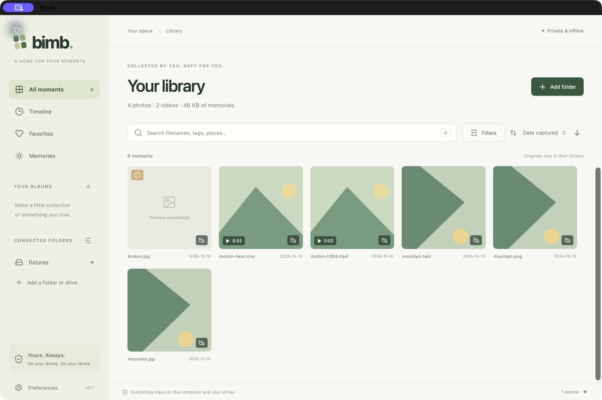
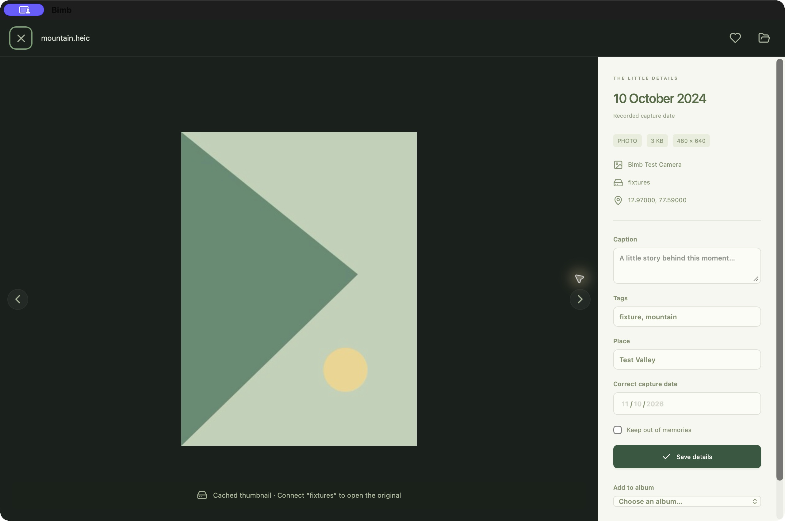

# Apple Silicon preview validation

10–11 October 2026. Local development preview; this is not a general availability or cross-platform certification.

## Environment and commands

- Apple Silicon Mac, macOS 26.3.1 (a); package minimum macOS 26.
- Rust 1.99.0, Node 24.14; dependency versions pinned in Cargo.lock and package-lock.json.
- SQLite 3.53.2, bundled through rusqlite 0.40.2.
- `npm run check`: zero errors and zero warnings.
- `cargo clippy --workspace --all-targets --offline -- -D warnings`: passed.
- `cargo test --workspace --offline`: all 10 targeted tests passed with native codec access.

## Automated evidence

| Test group | Verified behavior |
|---|---|
| Catalog, 3 tests | Literal full-text search, annotation search updates, pagination/ties, stale cursor rejection, valid date overrides, memory provenance and exclusions. |
| Library, 6 tests | Scan/rescan, rename identity and annotations, source overlap rejection, originals unchanged, offline thumbnails, relink, backup/restore and safety-backup restore, source interruption, budget enforcement, exclusive catalog lock, Unicode filenames/lossless path serialization, symlink rejection, corrupt media handling, watcher attachment reconciliation, and subsequent file-add notifications. |
| Desktop protocol, 1 test | Bounded video byte ranges, suffix/open ranges, invalid and out-of-bounds requests. |

Fixtures are synthetic JPEG, PNG, HEIC, H.264 MP4 and HEVC MOV, plus deliberately corrupt JPEG. Orientation, GPS and dimensions are checked. APFS rejects invalid UTF-8 filenames, so arbitrary-byte serialization is checked independently from actual Unicode filename I/O.

The interrupted-source test renames the root during a rescan of 40 images and verifies that all prior entries remain offline rather than becoming missing. It does not emulate every physical USB/filesystem failure.

## Native UI evidence

A packaged native window was tested with an isolated catalog and synthetic fixtures. The native folder picker, indexing, thumbnails, HEIC preview, H.264/HEVC video playback, place/tag editing, and search were exercised. The corrupt fixture remains visible with an attention state. The optimized 9.63 MiB bundle reopened its persisted catalog with the development server stopped. No personal media was used.

An attempted process-level network-denial smoke check did not expose a usable native window; it is not counted as a passed offline-network check. The full network-unavailable acceptance check remains open. UI resources and the local media protocol are bundled, and no application network client is configured.

On 11 October, the final native release displayed the HEIC cached thumbnail, capture metadata, GPS, saved tags and place label while the synthetic source directory was unavailable. The viewer explicitly requested reconnection for the original. The fixture folder was restored after the check. The native check also found a stale availability label in an already-open viewer; the UI now refreshes the selected asset when source state changes while keeping the separate, potentially unsaved annotation form intact. A native regression check confirmed that reconnecting removed the cached-view notice, loaded the original preview, and preserved an unsaved caption. This verifies an unavailable folder, not physical USB unplug behavior.

## Catalog benchmark

`cargo run -p bimb-core --example catalog_benchmark --offline` inserted 3,000 synthetic catalog rows and ran 100 text search/sort queries. Observed debug-build latency: **p50 18.8 ms; p95 21.5 ms**. These results include the local catalog queries and exclude media I/O and UI rendering. They are not a 1 TB import benchmark or a guarantee for an arbitrary drive.

## Current implementation choices

- One background decode worker at a time, plus a separate serialized preview worker. Both are subprocesses with output limits and a 25-second deadline; images are downsampled using native codecs. This bounds concurrency, not a hard OS-enforced RAM ceiling.
- Source scan state and discovered assets persist. Resume rewalks the source and skips unchanged completed work. Interrupted scans are visible for explicit resumption. A per-file durable queue and viewport-priority scheduling remain future refinements.
- Filesystem notifications debounce for two seconds. Source availability refreshes every 30 seconds; a 15-minute reconciliation repairs missed watcher events. Pause/cancel is respected. Scans retry incomplete operations on a later rescan.
- Relinks require the same volume UUID and root identity; a copied/replacement drive is a new source. Automatic remount lookup only handles unique matches below `/Volumes`.
- One SQLite actor serializes reads and writes. This is adequate for the measured 3,000-row workload; a dedicated read pool is not implemented.
- Date and named-place collections use filters and manual albums. Saved dynamic collections and a folder tree are not implemented. The error filter exposes media errors; folder traversal issues currently appear as source attention counts rather than a detailed per-folder report.
- Image GPS is normalized; video location metadata is retained as raw text and is not yet available to the GPS filter. EXIF offsets are retained; date grouping uses recorded wall time, and filesystem-date fallbacks are excluded from memories unless overridden.
- Still previews are capped at 2,560 pixels. Thumbnails are capped at 512 pixels. Full-resolution originals can be opened explicitly in another application.
- Catalog backups preserve organization and source references, not originals or thumbnails. Restoring marks thumbnails for regeneration; disconnected sources may need reconnecting to repopulate thumbnails.
- Live Photo still/video components remain separate. No ML, remote maps, account, telemetry, updater, transcoding pipeline, or arbitrary plugins.

## Remaining release gates

- Validate a representative subset of the user's phone exports, including audio, HDR, rotation, variable frame rate, long videos, and any motion-photo variants.
- Measure initial scan, warm rescan, UI latency and combined memory on the actual 3,000-file / 1 TB library.
- Physical external-drive hot unplug/reconnect and filesystem-specific identity tests (including exFAT); source permission changes, app termination at commit boundaries, disk-full injection, and invalid/migration recovery scenarios.
- Detailed folder error reporting, viewport-priority decoding, saved dynamic collections, and a full implementation review against the approved architecture before declaring the complete first release.
- Public distribution requires signing/notarization and a license decision. Windows and Intel/macOS compatibility need their own native adapters and validation phase.
